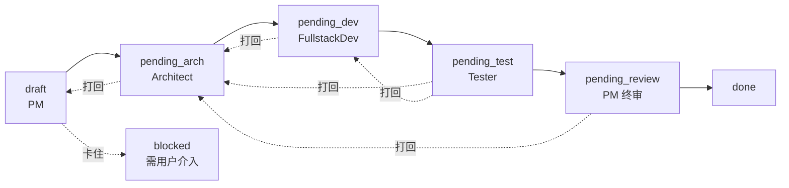
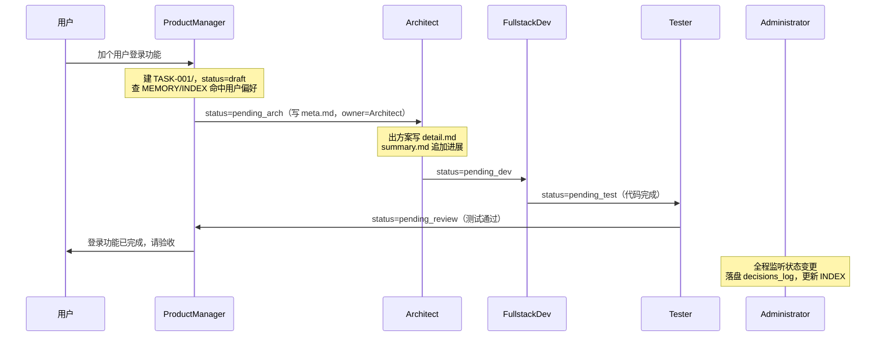

# CodeTeam-MD 设计文档

**版本**：v1.1  
**日期**：2026 年 6 月  
**作者**：基于用户需求，与 Grok、Claude 共同设计，结合 Anthropic 多 Agent 工程实践完善  
**目标**：构建一套**轻量、Markdown 原生、宿主无关（host-agnostic）的 Agent 团队编排层**——它本身不是 Agent，而是一套协作规范，让 Codex、Claude Code、CodeBuddy 等现成 CLI Agent 协作成一支软件开发团队。**适用于各类软件开发项目**——短周期项目可即开即用，**长期客户项目（数月乃至跨年）则尤其受益于其记忆沉淀与自我进化能力**。

**核心理念**：
- **宿主无关**：不自带运行时、不调用 LLM API，寄生于现有 CLI Agent 之上，跨宿主通用（区别于 CrewAI/AutoGen 等代码框架）
- 以 Markdown 为核心载体（人类与 Agent 均可读）
- 每个 Agent 使用独立目录管理
- 强化的长期记忆系统 + 用户习惯学习机制
- Administrator 负责记忆管理、用户反馈闭环、技能自动迭代
- 支持外部技能安装与动态分发
- 通过用户否定反馈（如“你说的不对”、“重做”）持续自我升级

---

## 1. 框架概述

**CodeTeam-MD** 是一个 **Markdown 原生、宿主无关（host-agnostic）的 Agent 团队编排层（Orchestration Layer）**。

一句话定位：**它本身不是 Agent，而是一套用 Markdown 写成的协作规范，让 Claude Code、Codex、CodeBuddy 等现成 CLI Agent 按统一的角色、记忆、工作流协议协作，组成一支软件开发团队。**

### 1.1 品类定位：它是什么 / 不是什么

| ✅ 它是 | ❌ 它不是 |
|--------|----------|
| 一套 Markdown 协作规范 / 编排层 | 一个自带运行时的代码框架（如 CrewAI / AutoGen / LangGraph） |
| 寄生于现有 CLI Agent 之上的"团队骨架" | 一个独立的 Agent / 自己调用 LLM API 的程序 |
| 宿主无关，跨 Claude Code / Codex / CodeBuddy 通用 | 绑定特定厂商或特定模型的工具 |
| 类比：MCP 是"工具协议"，本框架是"团队协作协议" | 一个需要安装重型依赖的运行引擎 |

> 它**包含**多 Agent 协作能力，但品类上更准确的称呼是"Agent 团队编排层 / 协作规范"——这正是它区别于传统多 Agent 代码框架的核心：**纯 Markdown、寄生于现有 Agent、跨宿主通用、自身不执行模型**。

### 1.2 核心特点

- 纯 Markdown 定义角色、技能、工作流、记忆（人类与 Agent 均可读）
- 每个 Agent 独立目录，便于管理、调试和版本控制
- 支持长期记忆（项目跨周期不丢失关键信息，长期项目尤其受益）
- Administrator 作为记忆管家与进化引擎，重点处理用户习惯与纠错
- 轻量运行在现有 CLI Agent（Codex / Claude Code / CodeBuddy 等）之上，无需重型框架
- 技能可外部安装，并通过用户反馈自动迭代升级

**适用场景**：各类软件开发项目均可使用；尤其适合需求频繁迭代、大型代码维护、跨周期长期服务客户等场景——项目周期越长，记忆沉淀与自我进化的价值越大。

---

## 2. 目录结构

```bash
CodeTeam-MD/
├── AGENTS.md                    # 全局团队规则、通讯协议、风格指南
├── WORKFLOW.md                  # 主工作流定义（状态机）
├── orchestrator.py              # 可选轻量编排脚本（后续增强，初期不依赖）
├── admin_panel/                 # 可选 Web 管理面板（单文件服务+静态页,读写本地Markdown）
├── SHARED/                      # 跨 Agent 共享资源
│   ├── MEMORY/                  # 长期记忆核心（三层加载）
│   │   ├── INDEX.md             # 【常驻】记忆索引，每条一行，启动即加载
│   │   ├── core/                # 【常驻】永不过期的关键事实
│   │   │   ├── project_summary.md   # 项目概览、技术栈、关键约束
│   │   │   └── user_preferences.md  # 用户习惯核心文件
│   │   ├── recall/              # 【按需召回】凭 INDEX 关键词唤醒
│   │   │   ├── decisions_log.md      # 重要决策（append-only）
│   │   │   └── correction_cases.md   # 纠错案例库（append-only，重点）
│   │   └── archive/             # 【归档】历史压缩存档（按季度/年）
│   ├── SKILLS/                  # 全局技能库
│   │   ├── INDEX.md             # 技能索引（仅 description，渐进式披露）
│   │   ├── <skill-name>/
│   │   │   ├── SKILL.md         # frontmatter: name/description/scope
│   │   │   └── references/      # 技能细节文档，按需加载
│   │   └── archive/            # 技能旧版本（升级后归档）
│   └── TASKS/                   # 动态任务看板
│       ├── INDEX.md             # 【常驻】任务索引，每条一行带关键词
│       └── TASK-001/
│           ├── meta.md          # frontmatter 状态机（status/owner/from）
│           ├── summary.md       # 渐进式摘要（实质进展时追加，append-only）
│           └── detail.md        # 完整需求/方案/交接记录（按需加载）
├── ROLES/                       # 每个 Agent 独立目录
│   ├── ProductManager/          # 用户唯一对话入口 + 轻量调度
│   │   ├── role.md
│   │   ├── skills/              # 角色私有技能（SKILL.md）
│   │   ├── memory/
│   │   └── outputs/
│   ├── Architect/
│   ├── FullstackDev/
│   ├── Tester/
│   └── Administrator/           # 记忆与进化核心（幕后，不挡主链路）
│       └── reports/             # 每月《团队进化报告》存放处
├── EXTERNAL_SKILLS/             # 外部导入的技能（待 Administrator 审核）
└── OUTPUTS/                     # 项目交付物（PRD、设计文档等）
```

--- 

## 3. 角色定义

下表总览各角色在工作流（第 6 章）中的位置与读写对象，便于对照后续机制：

| 角色             | 负责状态                                   | 用户可见   | 读写的任务/记忆/技能                             |
| -------------- | -------------------------------------- | ------ | --------------------------------------- |
| ProductManager | `draft` / `pending_review` / `blocked` | ✅ 唯一入口 | 全部任务卡（调度）、读 INDEX/core、判断纠错级别           |
| Architect      | `pending_arch`                         | ❌      | 认领 owner=自己的任务卡、`skills/`（系统设计/Mermaid） |
| FullstackDev   | `pending_dev`                          | ❌      | 认领任务卡、读架构方案、写代码产出                       |
| Tester         | `pending_test`                         | ❌      | 认领任务卡、写 Bug 报告、可打回任意上游                  |
| Administrator  | 幕后（不占状态）                               | ❌      | 写 MEMORY/、审核 EXTERNAL_SKILLS、生成技能 diff  |

### 3.1 Product Manager（资深产品经理）

- **目录**：`ROLES/ProductManager/`
- **工作流位置**：唯一对话入口 + 轻量调度者，持有 `draft`/`pending_review`/`blocked` 状态
- **核心职责**：
    - 与客户沟通、需求澄清
    - 编写和维护 PRD、用户故事
    - 优先级排序、范围控制
    - 拆任务、按状态机自动流转给下游，终审后交付
    - 判断用户反馈级别（L1/L2/L3，详见第 5 章），疑似 L3 转 Administrator
    - UAT 验收、反馈收集
- **关键技能**：需求文档模板、利益相关者管理、验收标准制定

### 3.2 Architect（资深架构师）

- **目录**：`ROLES/Architect/`
- **工作流位置**：持有 `pending_arch`，可被任意下游打回
- **核心职责**：
    - 技术方案设计与可行性评估
    - 任务拆分（Epic → Task）
    - 代码架构 Review
    - HLD 文档输出、技术风险控制
- **关键技能**：系统设计、Mermaid 图表、技术选型

### 3.3 FullstackDev（资深全站开发）

- **目录**：`ROLES/FullstackDev/`
- **工作流位置**：持有 `pending_dev`，完成后流转 `pending_test`
- **核心职责**：
    - 具体代码实现与重构
    - 单元测试编写
    - 调试与集成
    - 代码自测与文档更新
- **关键技能**：遵循架构设计、现代技术栈实现

### 3.4 Tester（资深测试 / QA）

- **目录**：`ROLES/Tester/`
- **工作流位置**：持有 `pending_test`，根因在哪可打回哪（Dev 或 Architect）
- **核心职责**：
    - 测试用例设计（功能、边界、性能）
    - 测试执行与 Bug 报告
    - 回归测试
    - 测试文档编写
- **关键技能**：异常场景覆盖、自动化测试建议

### 3.5 Administrator（管理员 / 记忆管家 + 进化引擎）【核心角色】

- **目录**：`ROLES/Administrator/`
- **工作流位置**：幕后观察者，不占用任务状态，由实质进展事件触发
- **核心职责**：
    - 长期记忆管理（提炼、总结、压缩、检索，详见第 4 章）
    - 用户习惯提炼（持续更新 user_preferences.md）
    - 纠错闭环（处理 PM 转来的 L3，生成技能 diff 草案，详见第 5 章）
    - 技能观察、迭代提案与分发；外部技能审核（详见第 8 章）
    - 提供可选的 Web 管理面板（待确认事项/技能管理/进化报告，详见第 9 章）
    - 团队进度跟踪、冲突协调
    - 每月生成《团队进化报告》

## 4. 长期记忆系统

借鉴 Anthropic 多 Agent 系统经验（计划/历史落盘，上下文只保留当前轮）与 MIRIX/G-Memory 的分层思想，采用**外置存储 + 三级渐进式加载**，避免长期项目记忆膨胀撑爆上下文。

### 4.1 三层记忆结构

| 层级 | 目录 | 加载策略 | 内容 |
|------|------|---------|------|
| **常驻层** | `MEMORY/INDEX.md` + `MEMORY/core/` | 每次启动即注入 | 记忆索引；永不过期的关键事实（项目概览、用户习惯） |
| **召回层** | `MEMORY/recall/` | 凭 INDEX 关键词按需唤醒 | 决策日志、纠错案例（append-only） |
| **归档层** | `MEMORY/archive/` | 仅明确追溯历史时读 | 压缩后的过期内容（按季度/年） |

> 说明：原 v1.0 的"短期/中期/长期"是按时效划分，本版改为按**加载时机**划分（常驻/召回/归档），更贴合 CLI Agent 的上下文管理——短期记忆即 CLI Agent 自身的会话上下文，不在文件层管理。

### 4.2 三级渐进式加载（与任务、技能系统统一）

```
INDEX（常驻，每条一行） → 命中后读对应文件全文 → 需要时再读细节
```

- 启动时**只注入** `INDEX.md` + `core/`（体量受控，常驻）
- 用户/任务触发时，由 PM 在 INDEX 中**匹配关键词** → 按需读取 `recall/` 对应片段
- `archive/` 几乎不加载，仅在显式追溯时读取

`INDEX.md` 示例：

```markdown
- [PREF] 用户偏好 | 关键词: 简洁,最小复杂度,命名 | → core/user_preferences.md
- [DEC-007] 选用 PostgreSQL | 关键词: 数据库,选型 | → recall/decisions_log.md#dec-007
- [FIX-012] 架构过度设计纠错 | 关键词: 架构,复杂度 | → recall/correction_cases.md#fix-012
```

### 4.3 关键记忆文件

- `core/project_summary.md`：项目整体概览、技术栈、关键约束
- `core/user_preferences.md`：用户习惯与偏好（自我进化核心）
- `recall/decisions_log.md`：重要决策记录（append-only）
- `recall/correction_cases.md`：纠错案例库（append-only，详见第 5 章）

### 4.4 记忆写入流程（Administrator 专职 + 事件触发）

记忆由 **Administrator 专职整理**，避免各角色随意写入导致碎片化。触发方式为**实质进展事件驱动**（非定时轮询）：

1. 任务卡状态变更 或 纠错发生时，由当前 Agent 在交接日志中**通知 Administrator**
2. Administrator 提炼/总结，写入对应层级文件，并更新 `INDEX.md`
3. 涉及用户习惯 → 更新 `core/user_preferences.md`；涉及纠错 → 追加 `recall/correction_cases.md`
4. 召回层内容超过阈值或过期 → Administrator 压缩后移入 `archive/`，INDEX 同步更新

## 5. 用户习惯与纠错机制（自我进化核心）

纠错是框架对抗 **Agent Drift（长期交互行为漂移）** 的核心手段，对标 Anthropic 的 **Evaluator-Optimizer** 模式——用户充当 evaluator，框架据反馈迭代优化。

### 5.1 不靠死关键词，由 PM 判断反馈意图

v1.0 靠"不对/重做"等关键词捕获，存在**误触发**（用户可能在说代码逻辑而非 Agent 表现）。本版改由 **PM 判断反馈意图**，分三级处理：

| 级别 | 含义 | 示例 | 处理方式 |
|------|------|------|---------|
| **L1 内容纠正** | 针对本次产出的具体修改 | "这个函数名改成 camelCase" | 当场修改，**不进**纠错库 |
| **L2 偏好信号** | 反映用户一贯习惯 | "说过多次了，别用复杂方案" | **静默**更新 `user_preferences.md` + 记 `correction_cases.md`，不打断用户 |
| **L3 系统问题** | 暴露 Agent/技能缺陷 | "你又犯这个错了" | 记纠错库 + **生成技能升级草案，等用户确认** |

PM 判断为疑似 L3 时，转交 **Administrator 深度处理**（根因分析、生成技能 diff）。

### 5.2 L3 技能升级闭环（人在回路，Human-in-the-loop）

技能升级会改变系统未来行为，**必须用户确认才落地**，防止 Agent 自我改写失控：

```
检测到 L3 → Administrator 写纠错案例 + 根因分析
         → 生成 SKILL.md 的 diff 草案
         → PM 向用户呈现："建议将 Architect 技能改为 X，是否采纳？"
         ├─ 用户确认 → 写入 skills/，版本号 +1，旧版进 archive
         └─ 用户拒绝 → 仅保留纠错案例，不改技能
```

### 5.3 纠错案例结构（correction_cases.md）

在 v1.0 基础上增加**级别**与**确认状态**字段：

```markdown
### 2026-06-15 | L3 | TASK-001
**用户反馈**：你说的不对，重做
**场景**：架构方案过于复杂
**根因**：用户偏好简单可维护方案
**改进措施**：Architect 技能增加"默认最简方案"约束
**确认状态**：✅ 已采纳 / ⏳ 待确认 / ❌ 已拒绝
```

### 5.4 机制优势

- **分级处理**避免过度触发：日常修改（L1）不污染纠错库，只有真正的行为缺陷（L3）才触发技能进化
- **人在回路**保证安全：系统行为的改变始终由用户掌控
- **长期贴合用户风格**：L2 静默积累偏好，团队逐渐个性化
- **对抗漂移**：纠错案例作为锚点，防止长周期项目中 Agent 行为偏移

## 6. 工作流定义（状态机）

CodeTeam-MD 本质是**串行软件工程流水线**（PM→架构→开发→测试），对标 Anthropic 的 **Prompt Chaining + Orchestrator** 模式，而非并行广度调研。每个环节之间设**校验闸门（Gate）**，可打回。

### 6.1 核心状态流



| 状态 | owner | 含义 |
|------|-------|------|
| `draft` | PM | 需求收集中，尚未拆任务 |
| `pending_arch` | Architect | 待出技术方案 |
| `pending_dev` | FullstackDev | 待开发 |
| `pending_test` | Tester | 待测试 |
| `pending_review` | PM | 待 PM 终审（对客户负责，交付前质控） |
| `done` | — | 完成 |
| `rejected` | 对应上游 | 打回标记（带原因），回到对应上游阶段 |
| `blocked` | PM | 卡住，需用户决策 |

### 6.2 流转规则

1. **PM 是唯一出入口**：`draft` 进、`pending_review` 出，中间环节自动流转。用户全程只与 PM 交互，对 Architect/Dev/Tester 无感知。
2. **打回到任意上游（Gate）**：任何下游发现上游问题 → 置 `rejected` + 写明原因 → 回到**根因所在**的上游阶段（如 Tester 发现是架构问题，可直接打回 `pending_arch`），避免逐级踢皮球。
3. **blocked 触发用户介入**：Agent 自身无法解决（需求不明、外部依赖缺失）→ 置 `blocked` → PM 回头询问用户。这是**除"完成"外唯一会打断用户**的情况。
4. **每次状态变更**都会：① 在 `summary.md` 追加一条摘要（仅实质进展）；② 通知 Administrator（记忆/纠错的统一触发点）。

## 7. 通讯协议（共享 Markdown 黑板模式）

Agent 之间不直接对话，而是通过**共享 Markdown 文件**通讯，采用**黑板 + 拉取（pull）**语义：Agent 启动时扫描 `TASKS/`，认领 `owner == 自己` 的任务。

### 7.1 任务卡三文件结构

每个任务一个目录 `SHARED/TASKS/TASK-xxx/`：

| 文件 | 作用 | 加载时机 |
|------|------|---------|
| `meta.md` | frontmatter 状态机（status/owner/from/updated） | 扫描时读 |
| `summary.md` | 渐进式摘要，**仅实质进展时追加**（append-only） | 唤醒时读 |
| `detail.md` | 完整需求、方案、交接记录 | 按需读 |

`meta.md` 示例：

```markdown
---
id: TASK-001
status: pending_dev
owner: FullstackDev
from: Architect
updated: 2026-06-20
---
## 交接记录（append-only，不删改）
- [2026-06-20 Architect] 方案已设计，详见 detail.md
- [2026-06-20 FullstackDev] 接手开发
```

### 7.2 全局任务索引

`SHARED/TASKS/INDEX.md` 常驻加载，每条一行带关键词，用于**唤醒历史任务**：

```markdown
- [TASK-001] 用户登录模块 | 关键词: 登录,OAuth,JWT | status: pending_dev | → TASK-001/
- [TASK-002] 支付重构 | 关键词: 支付,退款,对账 | status: done | → TASK-002/
```

用户提到"登录那块" → PM 在 INDEX 匹配关键词 `登录` → 命中 TASK-001 → 渐进加载 summary/detail。

### 7.3 防冲突设计

- **交接记录 append-only**：只追加不修改，天然防写冲突、可回溯审计
- **单 owner 串行**：同一时刻一个任务只有一个 owner，无并发写
- **Administrator 是观察者**：直接读 TASKS/ 与日志，无需各角色主动"抄送"

## 8. 技能系统

技能直接复用 **Claude Code Skill 规范**（技能=文件夹 + `SKILL.md`），零成本对齐宿主 CLI Agent。

### 8.1 技能格式与渐进式披露

```
skills/code-review/
├── SKILL.md          # frontmatter: name, description, scope；正文为技能指令
└── references/       # 细节文档，按需加载
```

加载策略与记忆、任务统一为三级：启动时只读 `SKILLS/INDEX.md` 中各技能的 **description**，命中才读 `SKILL.md` 全文，细节再进 `references/`。

### 8.2 三级作用域

| 作用域 | 目录 | 适用 |
|--------|------|------|
| 全局 | `SHARED/SKILLS/` | 所有角色可用（如 Markdown 规范、Git 提交规范） |
| 角色私有 | `ROLES/<角色>/skills/` | 仅某角色（如 Architect 的 Mermaid 出图） |
| 外部导入 | `EXTERNAL_SKILLS/` | 第三方安装，审核后提升至上面两层 |

### 8.3 外部技能审核（必经）

外部技能不直接生效，**必须经 Administrator 审核**：检查 description、作用域、是否与现有技能冲突 → 通过后登记进 `SKILLS/INDEX.md` 才可被加载。

### 8.4 技能迭代闭环

接第 5 章 L3 纠错：

```
L3 纠错 → Administrator 生成 SKILL.md 的 diff 草案 → 用户确认
       → 写入对应 skills/，版本号 +1，旧版进 archive
```

## 9. 编排与管理面板（轻量优先）

### 9.1 编排说明

遵循 Anthropic「保持简洁、生产环境弱化重型框架」原则：

- **初期不依赖 `orchestrator.py`**：调度由 PM 在 CLI 内通过读写共享 Markdown 完成（认领/流转任务卡），轻量、可控、易调试。
- **`orchestrator.py` 作为可选后续增强**：当任务量增大、需要自动扫描 TASKS/ 并批量唤起角色时，再引入轻量 Python 脚本，但**不引入 CrewAI/LangGraph 等重型框架**，避免可观测性下降、成本/调度逻辑被隐藏。
- **可观测性基础**：append-only 交接日志 + 各级 INDEX，即为全链路可追溯的轻量埋点。

### 9.2 Administrator 管理面板（可选附加组件）

为人类用户提供一个**可视化的管理入口**，集中处理需要确认的事项、查看技能与进化报告。

**定位（守住核心原则）**：
- **可选附加件**：不安装也能运行——核心始终是 Markdown + CLI，面板只是更友好的交互皮肤。
- **单一数据源**：面板**不另存数据**，只是 `MEMORY/`、`SKILLS/INDEX.md`、待确认项等 Markdown 文件的**可视化读写层**。关掉面板，用 Markdown 照样能管理。
- **轻量技术栈**：本地单文件服务（如 Python + 静态 HTML）直接读写本地 Markdown，**不引数据库、不引重型前端框架**。

**三大功能区**：

| 功能区 | 内容 | 对应数据源 |
|--------|------|-----------|
| ⏳ 待确认 | L3 技能升级草案、外部技能审核请求，列表 + Approve/Reject 按钮 | `correction_cases.md`（待确认项）、`EXTERNAL_SKILLS/` |
| 🧠 技能管理 | 全部技能清单（作用域/版本）、启用/停用、查看 diff、回滚旧版 | `SKILLS/INDEX.md`、各 `SKILL.md`、`SKILLS/archive/` |
| 📊 进化报告 | 纠错趋势、用户偏好摘要、每月《团队进化报告》 | `correction_cases.md`、`core/user_preferences.md`、`ROLES/Administrator/reports/` |

**点击确认的数据流**（以 L3 技能升级为例）——网页点击等价于在 Markdown 里打勾：

```
用户在面板点 [Approve]
   → 后端将 correction_cases.md 对应案例状态改为 "✅ 已采纳"
   → 写入 SKILL.md（版本 +1），旧版移入 SKILLS/archive/
   → 更新 SKILLS/INDEX.md
   （等同于第 5.2 节人在回路确认，仅交互形式不同）
```

> 因为面板只读写既有 Markdown，CLI 用户与面板用户看到的状态始终一致，不存在双数据源分歧。

## 10. 端到端示例：走通一条完整流水线

以「为项目新增用户登录功能」为例，串联第 4–9 章全部机制。**用户全程只与 PM 对话**。

### 10.1 正常路径



**关键点**：每次状态变更都触发「summary.md 追加 + 通知 Administrator」，用户只在 `draft` 入口和 `pending_review` 出口看到 PM。

### 10.2 打回路径（Gate）

Tester 在 `pending_test` 发现登录态用了不安全的存储方式，**根因在架构**：

```
TE 置 status=rejected，原因「session token 存储方案不合规」
   → 直接打回 pending_arch（非逐级退给 Dev）
AR 修订方案 → 重新 pending_dev → pending_test → pending_review
```

### 10.3 blocked 路径（用户介入）

Architect 发现需求未明确「是否支持第三方 OAuth」，自身无法决策：

```
AR 置 status=blocked，问题挂在 detail.md
   → PM 读到 blocked → 回头问用户：要支持 Google/GitHub 登录吗？
   → 用户答复 → PM 解除 blocked，回到 pending_arch
```

### 10.4 纠错触发进化（L3）

用户验收时说「你们又把方案做复杂了，每次都这样」：

```
PM 判定为 L3（暴露 Architect 反复过度设计）
   → 转 Administrator：根因分析 + 写 correction_cases.md
   → 生成 Architect/skills/system-design/SKILL.md 的 diff 草案
     （新增「默认最简方案」约束）
   → PM 呈现给用户："建议给架构技能加最简方案约束，是否采纳？"
   → 用户确认 → 写入技能，版本 +1，旧版进 archive
```

下次同类任务，Architect 加载到升级后的技能，不再过度设计——**框架完成一次自我进化**。

## 11. 团队/组织级管理机制（新增章节）

### 11.1 问题背景
- 每个人安装 CodeTeam-MD 后，经过长期使用会产生个性化内容（`user_preferences.md`、`correction_cases.md`、自定义技能等）。
- 当框架需要**统一升级**（新增角色、更新通用技能、修复 Bug、优化工作流等）时，如何安全、高效地推送给所有人，同时**保留每个人的个性化定制**？

### 11.2 推荐解决方案：Git 中心化 + gitignore 隔离个性化

**核心原则：单一数据源**。个性化内容（用户习惯、纠错案例、自定义技能）**就地存放在原目录**（如 `SHARED/MEMORY/`），通过 `.gitignore` 排除上游同步，**不另建 `personal/` 副本**，避免同一份文件出现两处导致数据不一致。

**核心架构**：
- **上游仓库（Upstream）**：官方/团队维护的 CodeTeam-MD 标准版本（GitHub / GitLab / 公司内网），含通用角色、技能、工作流。
- **每个用户**：从 upstream fork 或 clone，拥有自己的分支（如 `user-alice`）。
- **个性化文件**：留在原位，由 `.gitignore` 屏蔽，上游升级时不会被覆盖。

#### 上游仓库（CodeTeam-MD）
- `main` 分支：标准模板 + 通用角色、技能、工作流
- `releases/` 或 tag 管理版本发布
- `SHARED/SKILLS/` 通用技能可被所有人同步更新

#### 个性化文件的 .gitignore 规则（关键）

```gitignore
# 用户习惯与纠错——属于个人，不上传上游
SHARED/MEMORY/core/user_preferences.md
SHARED/MEMORY/recall/correction_cases.md
SHARED/MEMORY/archive/
# 各任务运行态数据
SHARED/TASKS/TASK-*/
# 个人自定义/升级后的技能（区别于上游通用技能）
ROLES/*/skills/
SHARED/SKILLS/archive/
```

> 注：`project_summary.md`、`decisions_log.md` 是否上传，由团队决定——若多人协作同一项目可共享，若纯个人项目可一并 ignore。

#### 升级流程

```
上游发布新版 → 用户 git pull upstream main
            → 通用文件（WORKFLOW.md、通用技能、角色模板）更新
            → gitignore 保护的个性化文件原样保留
            → 冲突仅可能出现在两边都改过的通用文件，常规 merge 解决
```

### 11.3 与技能升级的衔接

第 8.4 节的 L3 技能升级写入 `ROLES/*/skills/`（已被 gitignore），因此**个人通过纠错进化出的技能不会污染上游**；若某项个性化技能被验证为通用最佳实践，可由维护者**手动提升**到 `SHARED/SKILLS/` 纳入上游，反向回馈团队。