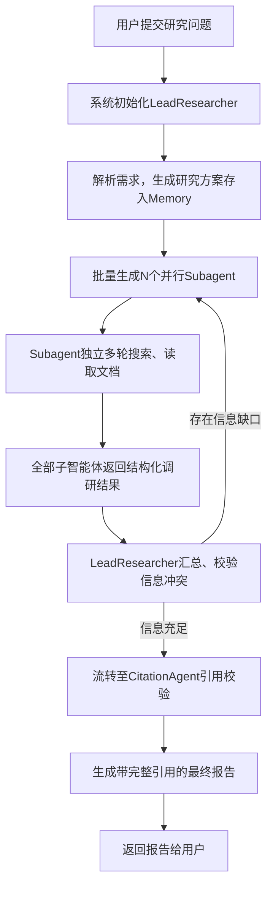

# How we built our multi-agent research system
> 原文地址：https://www.anthropic.com/engineering/multi-agent-research-system
> 发布日期：2025-06-13
> 作者：Jeremy Hadfield、Barry Zhang、Kenneth Lien、Florian Scholz、Jeremy Fox、Daniel Ford

## 博客封面图
（原文配图：多智能体系统架构封面示意图）

## 0 概述
Claude 现已上线 Research 深度研究功能，可全网、Google Workspace、第三方集成文档跨源检索，解决复杂调研需求。
整套多智能体系统从原型迭代至生产，沉淀了架构、工具、提示工程、线上稳定性全套工程方法论；系统采用**协调者-工作者（Orchestrator-Worker）** 模式，由主智能体统筹规划、批量生成并行子智能体分头检索，最终引用校验智能体统一溯源输出报告。

多智能体架构大幅提升复杂问题调研效果，但同时带来调度、成本、幻觉、状态管理等全新工程挑战，下文完整拆解原文全部内容。

## 1 为什么需要多智能体研究系统
### 1.1 传统单模型 / 静态 RAG 的固有缺陷
1. **上下文窗口限制**：海量网页、长文档无法一次性全部载入，信息承载存在硬性上限；
2. **串行检索效率低下**：单一智能体只能分步搜索，多维度调研耗时极长、覆盖范围窄；
3. **单一推理路径易遗漏信息**：固定思考逻辑容易忽略细分分支，调研广度不足；
4. **检索逻辑静态固化**：传统RAG一次性召回片段，无法根据中途获取的资料动态调整搜索关键词、数据源。

### 1.2 多智能体核心收益
多智能体本质是**横向扩展有效推理Token容量**：每个子智能体拥有独立隔离上下文，并行探索问题不同分支，实现广度优先全覆盖调研。

官方评测结论：
- 80% 的任务性能差异可由**总Token消耗量**解释；
- 并行化可将复杂调研任务耗时最高缩短90%；
- 完整多智能体系统对比单Opus 4，复杂调研正确率提升90.2%。

### 1.3 Token成本（原文重点提醒）
以普通单次对话为基准：
- 基础单轮对话：1x Token消耗
- 单智能体工具检索：约4x Token消耗
- 完整多智能体研究系统：约15x Token消耗

适用边界：
✅ 适合：高价值、高复杂度调研任务（市场尽调、学术综述、合规审查、技术深度调研）
❌ 不适合：简单问答、单文档摘要、强串行依赖写作、低成本轻量查询（成本收益失衡）

## 2 系统核心架构：Orchestrator-Worker 协调者-工作者
### 2.1 三层智能体角色分工
#### 2.1.1 LeadResearcher 主协调智能体（基座：Claude Opus 4）
全局总控单元，负责任务规划、调度、汇总、迭代判断：
1. 解析用户复杂查询，拆解为可并行执行的独立子任务；
2. 生成完整全局研究方案，存入独立持久化 Memory 存储；
    - 解决超大任务上下文溢出丢失调研计划的问题，主Agent仅保留当前轮次交互内容；
3. 批量创建并行Subagent，为每个子智能体分配专属调研目标、边界约束、输出规范；
4. 收集全部子智能体结构化输出，交叉校验信息冲突、识别信息缺口；
5. 迭代决策：信息不足则新增专项子智能体补充检索；信息完备则流转至引用校验模块；
6. 支持多轮循环调研，动态修正搜索方向、调整子任务数量。

#### 2.1.2 Subagent 子工作智能体（基座：Claude Sonnet 4）
并行执行单元，完全隔离运行：独立上下文、独立工具调用权限、独立检索链路
1. 接收主Agent下发的细分调研目标、数据源限制、结构化输出格式；
2. 采用「思考+检索穿插」交错推理模式，循环调用网页读取、文档解析工具；
3. 实时评估检索内容质量，动态调整搜索关键词、拓宽/缩小检索范围；
4. 统一以结构化JSON输出：调研结论、原始来源链接、关键数据、信息可信度判断，回传给主协调器。

#### 2.1.3 CitationAgent 引用校验专用智能体（后置质控）
专门解决AI幻觉、无依据断言、溯源缺失问题：
1. 汇总所有子智能体产出的网页、文档原始信源；
2. 逐条匹配报告结论与原文段落，精准绑定引用标记；
3. 过滤无原始资料支撑的推测、虚假数据；
4. 标准化排版，输出带完整参考文献索引、逐条标注引用的正式调研报告。

### 2.2 完整迭代执行流程

## 3 提示工程设计
原文强调：多智能体提示词不是简单指令，而是**研究策略的编码**，分层设计三大提示模板。

### 3.1 主协调Agent提示体系
核心约束规则：
1. 任务拆分标准：优先拆分为互不重叠、可并行的独立子问题；
2. 资源缩放规则：根据问题难度动态调整子智能体数量；
3. 冲突信息处理：多源内容矛盾时记录分歧，不自行臆断取舍；
4. 终止判断逻辑：明确「信息充足」的量化标准（覆盖核心维度、多信源交叉印证）；
5. 强制开启扩展思考模式（Extended Thinking），作为规划草稿区。

### 3.2 子智能体专用提示模板
1. 搜索策略规范：先宽范围短关键词检索，再逐步缩小精准查询；
2. 工具调用护栏：限制无效重复搜索，强制评估每轮文档价值；
3. 边界约束：禁止跨任务调研，避免子Agent偏离分配目标；
4. 输出强制结构化JSON，降低主Agent解析损耗；
5. 穿插思考机制：每次读取网页后复盘信息缺口，优化下一轮搜索。

### 3.3 通用优化手段
1. 护栏（Guardrails）：设置智能体行为限制，防止无限循环检索、算力失控；
2. 工具测试专用Agent：自动验证MCP工具可用性，优化工具描述，可缩短40%任务耗时；
3. 统一输出范式：全链路标准化结构化返回，消除跨智能体格式兼容问题。

## 4 系统评估体系（LLM-as-Judge评测方案）
### 4.1 评测数据集
- 高难度真实业务调研样本：行业分析、学术综述、法律尽调、技术排查；
- 人工标注三大核心评分维度：信息完整覆盖率、事实幻觉率、逻辑严谨度、引用溯源准确率。

### 4.2 三组对照评测方案
1. 基线1：单大模型（Opus 4）无工具检索；
2. 基线2：单智能体带工具检索；
3. 实验组：Orchestrator-Worker多智能体系统（Opus协调+Sonnet子Agent）。

### 4.3 评测核心结论
1. Token总量是性能第一影响因素，并行多智能体可低成本提升有效Token投入；
2. 异构模型搭配（高端模型统筹、轻量模型执行）性价比远高于全部使用顶级模型；
3. 多智能体方案幻觉发生率显著低于单智能体，多源交叉验证天然降低虚假结论；
4. 并行检索大幅提升信息广度，单模型极易出现维度遗漏。

## 5 生产落地核心工程难点
### 5.1 上下文溢出风险
- 问题：长周期调研累积数万字检索文本，极易触达模型上下文上限；
- 解决方案：独立持久Memory存储全局调研计划，各Agent仅保留单轮交互内容，不缓存全部历史检索文本。

### 5.2 错误链式放大
- 问题：单个子智能体检索错误、虚假结论会被主Agent汇总采信，层层放大偏差；
- 解决方案：多子Agent同维度交叉验证、后置CitationAgent强制溯源、冲突信息标记存疑不直接采信。

### 5.3 多并行任务状态管理复杂
- 问题：异步子智能体超时、工具调用失败、任务中断难以追踪定位；
- 解决方案：全链路任务状态日志、子智能体失败自动重试、调度中心限流管控并发量。

### 5.4 并发成本失控
- 问题：批量同时启动大量子智能体，瞬间Token消耗暴涨；
- 解决方案：动态分支数量控制、分级限流、简单子任务优先使用低成本Sonnet模型。

### 5.5 调试与可观测性困难
多智能体系统具备强非确定性，每轮子Agent检索路径不固定，复现故障难度极高；团队配套完整链路埋点、每一个Agent输入输出日志、检索记录全留存，快速定位检索/提示/调度问题。

## 6 适用场景与禁用场景
### 6.1 推荐使用多智能体Research功能
1. 高价值并行调研：市场竞品分析、行业深度报告、学术文献综述、金融/法律尽调；
2. 信息体量超大：需要整合数十至上百份网页、企业文档、专业资料；
3. 多工具联动场景：同时调用网页搜索、企业网盘、第三方数据库API。

### 6.2 不建议使用多智能体架构
1. 任务强串行依赖，无法拆分为并行子任务（长篇连贯小说、完整代码工程编写）；
2. 简单单文档阅读、短句问答、基础摘要，算力成本远高于收益；
3. 对响应速度有极致要求的轻量查询。

## 7 线上用户场景分布（官方数据）
多智能体Research功能用户任务占比：
1. 软件系统开发调研：10%
2. 业务增长策略调研、专业技术内容创作：各8%
3. 学术研究/教育材料编写：7%
4. 信息核查、行业深度研究：5%
剩余场景：医疗调研、法律文书检索、金融数据分析等专项专业调研。

## 8 核心总结与工程启示
1. 多智能体的核心价值不是「多个模型同时运行」，而是**可横向扩展的并行问题求解架构**，突破单模型上下文、串行推理两大瓶颈；
2. 多智能体系统落地上限由传统后端工程能力决定：并发调度、状态存储、容错重试、可观测性，而非仅依赖提示词调优；
3. 异构模型分层搭配（高端模型做协调、轻量模型做执行）是生产环境最优性价比方案；
4. 多智能体不是通用万能方案，必须结合任务复杂度、并行拆分空间、算力成本做取舍；
5. 质控层（引用校验Agent）是生产环境必备模块，专门压制多智能体协作带来的幻觉风险。

## 9 致谢
本系统由 Anthropic 多团队协同落地完成，特别感谢应用工程团队完成系统生产化；同时感谢早期内测用户提供大量真实业务反馈，持续迭代优化Research多智能体系统。